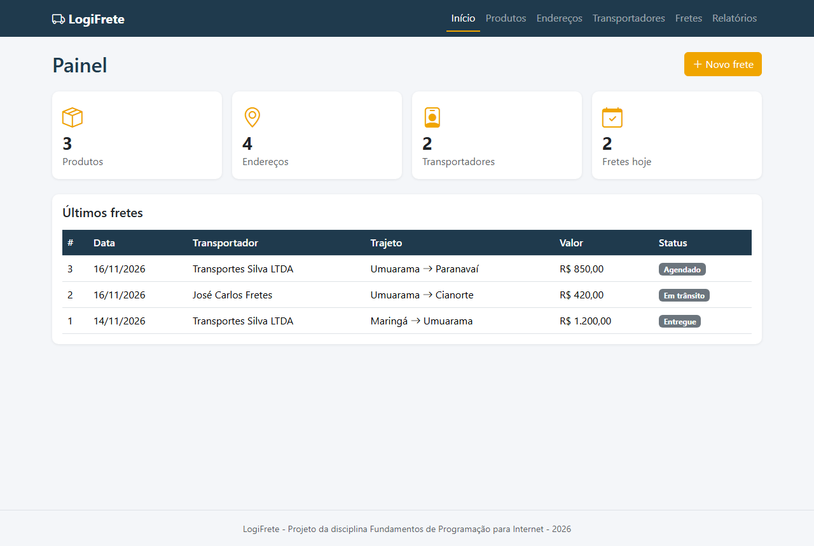
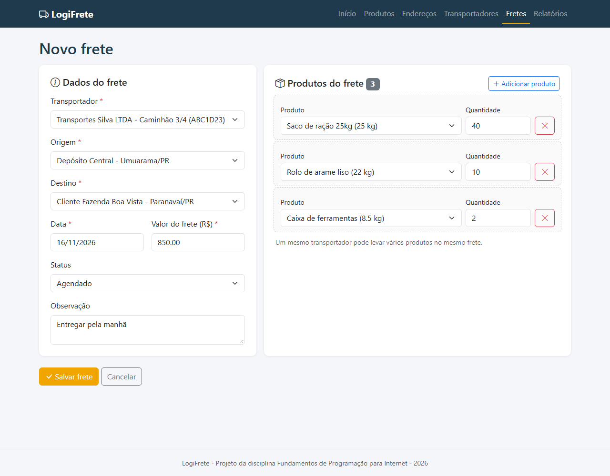
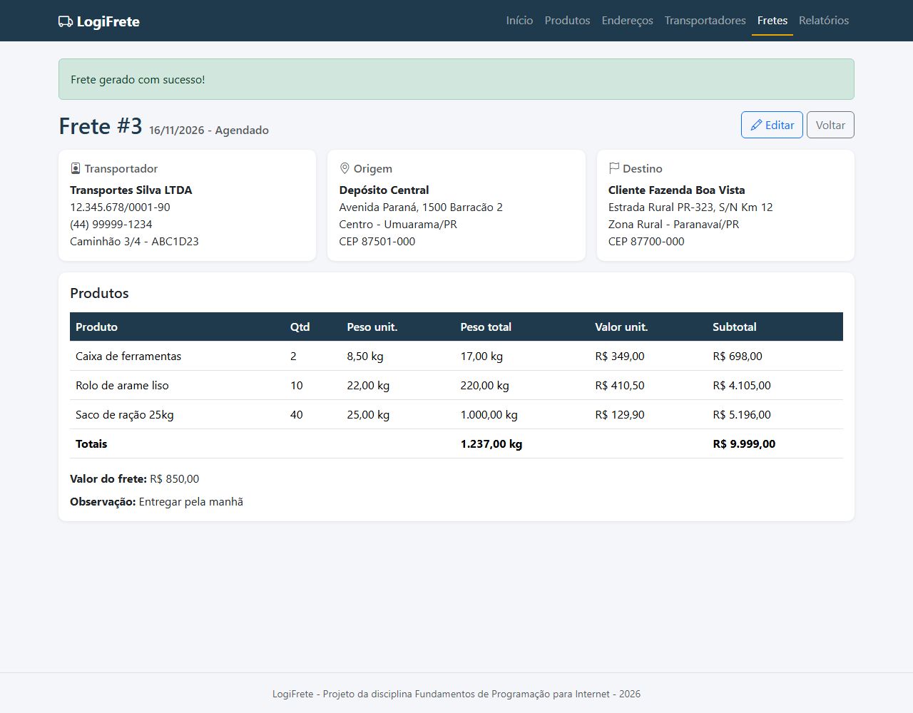
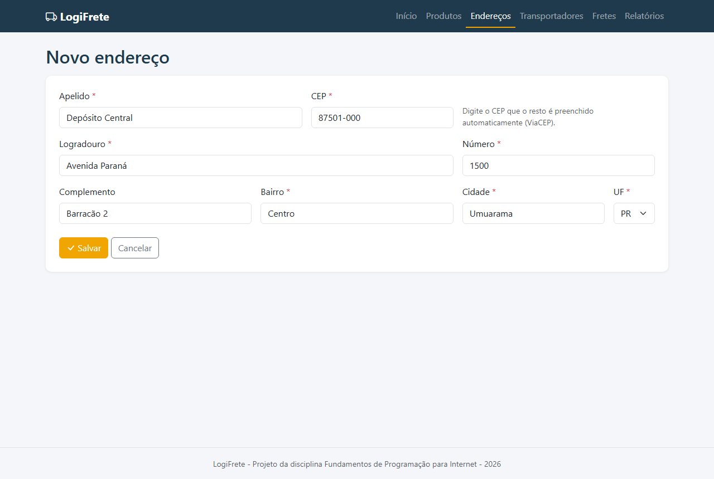
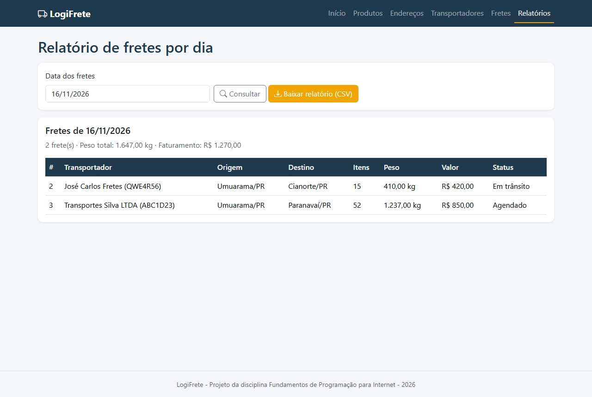

# LogiFrete - Gerenciador Logístico

Projeto da Atividade Prática Orientada da disciplina **Fundamentos de Programação para Internet** (ADS - UNIPAR EAD).

É um sistema web simples para controle de fretes. Dá pra cadastrar produtos, endereços e transportadores e depois gerar um frete juntando tudo, onde um transportador pode levar vários produtos de uma vez. Também tem um relatório dos fretes do dia que pode ser baixado em CSV.



## Tecnologias

- PHP 8 (PDO)
- MySQL / MariaDB
- HTML, CSS e JavaScript
- Bootstrap 5 e Bootstrap Icons
- API do [ViaCEP](https://viacep.com.br/) para preencher o endereço pelo CEP
- XAMPP para rodar local

## Funcionalidades

- Cadastro, edição, busca e exclusão de **produtos**, **endereços** e **transportadores**
- Geração de **fretes** com origem, destino, transportador e vários produtos (os campos de produto são adicionados/removidos com JavaScript)
- Tela de detalhes do frete com peso total, valor da mercadoria e aviso se passar da capacidade do veículo
- Filtro de fretes por data e status
- **Relatório** dos fretes de um dia com download em CSV (abre no Excel)
- Não deixa excluir produto, endereço ou transportador que já está em algum frete

## Como rodar

1. Instale o [XAMPP](https://www.apachefriends.org/) e inicie o **Apache** e o **MySQL**
2. Clone o repositório dentro da pasta `htdocs`:
   ```bash
   cd C:\xampp\htdocs
   git clone https://github.com/SEU-USUARIO/gerenciador-logistico.git
   ```
3. Abra o phpMyAdmin (http://localhost/phpmyadmin), vá em **Importar** e selecione o arquivo `database/banco.sql`
4. Acesse http://localhost/gerenciador-logistico

Se o MySQL tiver senha ou a pasta tiver outro nome, é só ajustar o `config/conexao.php`.

## Estrutura de pastas

```
gerenciador-logistico/
├── assets/
│   ├── css/style.css
│   └── js/scripts.js
├── config/
│   ├── conexao.php       # conexão PDO e sessão
│   └── funcoes.php       # funções auxiliares
├── database/
│   └── banco.sql         # criação das tabelas + dados de exemplo
├── docs/telas/           # prints das telas
├── enderecos/
├── fretes/
├── includes/             # header (menu) e footer
├── produtos/
├── relatorios/
├── transportadores/
└── index.php             # painel inicial
```

Cada módulo tem os arquivos `listar.php`, `form.php` (cadastro e edição), `salvar.php` e `excluir.php`.

## Banco de dados

| Tabela | Descrição |
|---|---|
| produtos | produtos que podem ser transportados |
| enderecos | endereços usados como origem ou destino |
| transportadores | transportador e dados do veículo |
| fretes | frete com transportador, origem, destino, data e valor |
| frete_produtos | produtos de cada frete (ligação 1 frete -> N produtos) |

## Telas

| Novo frete | Detalhes do frete |
|---|---|
|  |  |

| Cadastro de endereço | Relatório |
|---|---|
|  |  |

## Autor

Luiz Bianchini - Análise e Desenvolvimento de Sistemas
